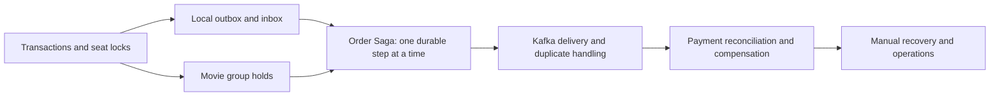

# Tutorial index and learning guide

Updated 2026-10-18. Start here when you want to **study the project**, then open
one linked lesson at a time. [Project status](PROJECT_STATUS.md) records delivered
work; [worklog](WORKLOG.md) records what actually ran. Neither proves that you
have learned a topic yet.

Current hands-on learning has just started with **GET /api/events**, the first
endpoint tried in this session ([short handover](NEXT_SESSION_HANDOVER.md#learning-handover--2026-10-18),
[existing API 2 guide](API_02_LIST_EVENTS_WALKTHROUGH.md)). Resume its IDE flow;
advance only when ready. The older saved course point was **API 3: GET event**,
which is the next proposed endpoint, not completed in this new sequence.
The new Order Saga is implemented, but it is a
separate learning track; you do not need to jump to it before you are ready.
Reading a tutorial or index does not authorize service startup, tests, fault
experiments, or load. Runtime sections are instructions for a separately selected
hands-on session. Never run Maven `clean`, delete files, or reset retained data.

## Choose where to start

| Your goal today | Start with | Stop after |
| --- | --- | --- |
| Continue the saved API course | [API 3 walkthrough](API_03_GET_EVENT_WALKTHROUGH.md) | Its exercise; ask to advance when ready |
| Understand transactions before booking logic | [Foundations](DISTRIBUTED_SYSTEMS_FOUNDATIONS.md), then [two lambdas](API_01_LAMBDA_EXECUTION_WALKTHROUGH.md) | Explain when `work.get()` executes |
| Understand the new Kafka order workflow | Local outbox and movie booking prerequisites below, then [Order Saga](ORDER_SAGA_TUTORIAL.md) | First pass: accepted order and durable command |
| Practise an interview answer | [Interview guide](INTERVIEW_GUIDE.md) | One track and one spoken example |
| Operate or repair the new workflow | [Order Saga runbook](ORDER_SAGA_RUNBOOK.md) plus [verification](ORDER_SAGA_VERIFICATION.md) | Read first; execute only selected actions |

## How to use one study session

Saved format: when you say **API**, show one HTTP method/URL, its parameters,
relevant headers/body, status code and a short response excerpt when invoked,
followed by a compact IDE stack: controller class/method -> service class/method
-> repository or actual store/JDBC method -> SQL/table, with source links. Use
the actual persistence layer; this project does not always have a repository.
Pause after that endpoint until you ask to continue.
Update the linked API walkthrough along the way with this compact note; reuse
its existing explanations rather than rebuilding the tutorial. Label omitted
response fields/items and keep observed results distinct from examples.

Allow about 20–35 minutes; spend longer when the code is unfamiliar.

1. Read the lesson's problem and one section. State the invariant in one sentence.
2. Open the named Java entry point in IntelliJ. Follow one request into SQL;
   mark where its transaction starts, commits, and releases locks.
3. Draw the rows and state changes for a tiny example: one seat or one group.
4. Answer the checkpoint without looking at the tutorial. Do its paper exercise.
5. Say three interview points aloud. Note what is still unclear, then pause.

Use a paper note with `lesson / entry method / invariant / unclear question`.
Do not advance automatically because a file is implemented or its tests pass.
Use debugger/runtime exercises only after choosing that hands-on session.

## Route A — foundations and one API at a time

| Order | Guide | What to learn | Ready-to-move-on checkpoint |
| --- | --- | --- | --- |
| A1 | [Distributed-systems foundations](DISTRIBUTED_SYSTEMS_FOUNDATIONS.md) | Transactions, row locks, expiry, retries, pessimistic versus proposed optimistic locking | Explain why two concurrent requests cannot both own one seat |
| A2 | [API 1: create event](API_01_CREATE_EVENT_WALKTHROUGH.md) | HTTP validation, service, transaction helper, event/seat inserts | Identify which inserts roll back together |
| A2a | [API 1: two lambdas](API_01_LAMBDA_EXECUTION_WALKTHROUGH.md) | `Supplier<T>`, `TransactionTemplate.execute`, `work.get()` | Distinguish passing work from executing work |
| A3 | [API 2: list events](API_02_LIST_EVENTS_WALKTHROUGH.md) | Query parameters, pagination, row mapping | Trace one list response from SQL to JSON |
| A4 | [API 3: get event](API_03_GET_EVENT_WALKTHROUGH.md) | UUID lookup and missing-resource behavior | Explain 200 versus 404 for this endpoint |
| A5 | [IntelliJ booking study](INTELLIJ_CODE_STUDY_TUTORIAL.md) | Seat hold, checkout, provider result, recovery and cancellation | Name the seat-before-booking lock order and why it matters |

A2–A4 are separate lessons. A5 is a map of later code, not permission to rush
past the saved API 3 pause point. Open the standalone root `pom.xml` in
`D:/sd-book-my-show`, using Java 21. The gateway and Java loader have independent
POMs; importing them is optional for their later lessons.

## Route B — generic booking failure scenarios

Read after the basic booking trace. These lessons concern the original generic
single-seat booking domain. Work through one scenario per session or split it
at its pause points.

| Order | Guide | Main question | Source entry point |
| --- | --- | --- | --- |
| B1 | [Scenario 1: API failover](API_FAILOVER_TUTORIAL.md) | What if an API commits, then stops before replying? | `AdmissionGate`, `AdmissionFilter`, `BookingService` |
| B2a | [Scenario 2 protection study](SCENARIO_02_PROTECTION_STUDY.md) | Which boundary owns each timeout, limit and retry? | `ProviderBoundary`, `PaymentProcessor` |
| B2b | [Scenario 2: provider isolation](PROVIDER_ISOLATION_TUTORIAL.md) | How do bulkheads, deadlines and durable budgets prevent amplification? | `ProviderBoundary`, `RecoveryIsolation` |
| B3 | [Scenario 3: poison jobs](POISON_JOB_TUTORIAL.md) | How can one broken payment stop hurting healthy work? | `PaymentProcessor`, `RecoveryIsolation`, V3 |
| B4 | [Scenario 4: local transactional outbox](TRANSACTIONAL_OUTBOX_TUTORIAL.md) | What survives a crash between state commit and notification delivery? | `OutboxDispatcher`, `LocalNotificationSink`, V4 |

Checkpoint: distinguish a payment's business outcome from delivery status,
explain token plus unexpired lease fencing, and describe why duplicate delivery
still occurs. B4 uses a **local notification sink**, not Kafka. The new Kafka
workflow in Route D is a separate implementation, not a retrofit of V4.

## Route C — movie inventory and advance booking

| Order | Guide | Main question | Suggested first section |
| --- | --- | --- | --- |
| C1 | [Movie group booking](MOVIE_BOOKING_TUTORIAL.md) | How can 1–10 seats be held atomically across classes? | Domain relationships and one atomic group |
| C2 | [Movie advance booking](MOVIE_ADVANCE_BOOKING_TUTORIAL.md) | How do permanent cinemas produce a rolling show window? | Parts 1–2: catalog and window fill |
| C3 | Same advance-booking guide | How do purge, timezone, JIT and resource limits affect correctness? | One of parts 3–8 per session |
| C4 | [PVR catalog/schedule reference](PVR_CATALOG_SCHEDULE.md) | Which data is permanent and which inventory is generated? | Schema and rolling-window contract |

Read [movie API reference](MOVIE_API_REFERENCE.md) alongside C1 and
[movie verification](MOVIE_VERIFICATION.md) when checking which behavior was
actually exercised. The old movie payment route records refund obligations;
Route D executes simulated refunds through the copied gateway.

Current retention exception: the maintainer excludes shows referenced by
`order_inventory`, including terminal saga bookings. Old purge measurements
predate this protection. Do not remove reconciliation evidence to make the
catalog smaller.

## Route D — the new Order Saga with Kafka

Prerequisites: A1, a basic hold/checkout trace from A5, B4 and C1. You can skip
the load-testing track before studying the saga. Keep the
[implementation plan](ORDER_SAGA_PLAN.md), [original brief](ORDER_SAGA_BRIEF.md),
and [verification](ORDER_SAGA_VERIFICATION.md) as references, not first lessons.

Use [Order Saga tutorial](ORDER_SAGA_TUTORIAL.md) for each row below. One pass is
one sitting; split a pass if necessary.

| Pass | Learn | Open these sources | Paper checkpoint |
| --- | --- | --- | --- |
| D1 | Accepted order, server prices, canonical request and saved 202 response | [OrderController](../src/main/java/com/example/booking/OrderController.java), [OrderService](../src/main/java/com/example/booking/OrderService.java), [V8](../src/main/resources/db/migration/V8__order_saga.sql) | Which rows must survive before 202 is returned? |
| D2 | Relay claim, Kafka ack, inbox, manual offset commit | [OrderRelay](../src/main/java/com/example/booking/OrderRelay.java), [OrderKafka](../src/main/java/com/example/booking/OrderKafka.java), [OrderStore](../src/main/java/com/example/booking/OrderStore.java) | Why can a published message be delivered again? |
| D3 | Reserve → capture → commit → confirm | [OrderInventory](../src/main/java/com/example/booking/OrderInventory.java), `OrderService.consume/advance` | Why is captured payment alone insufficient? |
| D4 | Durable provider operation, HTTP ambiguity, GET then same-ID POST | [OrderPayment](../src/main/java/com/example/booking/OrderPayment.java), [copied gateway guide](../mock-payment-gateway/README.md) | A response is lost after charge: which UUID is reused? |
| D5 | Cancellation tombstones, refund, CancelBooking, late replies | `OrderService.advance`, `OrderInventory.consume`, `OrderPayment.consume` | What if cancellation arrives before reserve? |
| D6 | Recovery budget, durable stop intent, audited resume and retention | [OrderOperations](../src/main/java/com/example/booking/OrderOperations.java), [OrderWorkers](../src/main/java/com/example/booking/OrderWorkers.java), [runbook](ORDER_SAGA_RUNBOOK.md) | Why must a resumed compensating saga never confirm? |
| D7 | Regression-driven correctness lessons | Tutorial section “Review fixes to study”, [saga tests](../src/test/java/com/example/booking/OrderSagaIntegrationTest.java), [Kafka tests](../src/test/java/com/example/booking/OrderKafkaIntegrationTest.java) | Explain one bug using its failing test and durable fix |

There is no real payment, production customer authentication or broker HA claim.
The shared API token authorizes a trusted caller to assert `X-Customer-Id`.
Provider and operator tokens are distinct. Do not mistake these development
boundaries for a deployed customer security model.

## Keep the three booking flows separate

| Flow | Main API | Delivery/payment behavior | Read |
| --- | --- | --- | --- |
| Generic single-seat booking | `/api/holds`, `/api/bookings/...` | Generic provider/recovery; V4 local notification outbox | Routes A–B |
| Legacy movie group booking | `/api/movie/holds`, `/api/movie/bookings/.../checkout` | Existing movie mock; refund flag records an obligation | Route C |
| Optional order workflow | `/api/orders`, `/api/orders/{id}/cancel` | Kafka commands/replies, durable saga, copied gateway capture/refund | Route D |

Saga-owned movie bookings reject legacy checkout/cancel even at the service
transaction boundary. Existing movie loaders still target the legacy movie API;
they do not exercise the new order saga. Confirmed order cancellation is rejected
until a separate ticket/refund policy is selected.

## Route E — optional load generators and performance study

Study after correctness and recovery. The ordering is conceptual; it does not
select a workload or permit replaying an old experiment.

| Order | Guide | Learning goal |
| --- | --- | --- |
| E1 | [Node hold/retry comparison](HOLD_LOAD_TEST_TUTORIAL.md) | Immediate versus jittered retries, ambiguity and discovery |
| E2 | [Docker 10 RPS tutorial](DOCKER_LOAD_TEST_TUTORIAL.md) | Isolated resource budgets and interpreting a finite historical run |
| E3 | [Java virtual-thread loader](JAVA_LOAD_TESTER_TUTORIAL.md) | Open arrivals, bounded concurrency, deadlines and retained results |
| E4 | [Movie advance-booking guide](MOVIE_ADVANCE_BOOKING_TUTORIAL.md) | Movie journeys, resource observations and the stopped 2026-10-07 run |
| E5 | [Ankita PostgreSQL runbook](ANKITA_POSTGRES.md) | Private connectivity, database placement and latency budgets |

The Java loader is the selected implementation; Node remains a comparison.
Remote Ankita execution, Redis, shared admission and future high-throughput
features remain separate selections. A client cap is not shared server admission.

## Interview practice and progress

After a lesson, choose its three to five interview points or one question from
the [interview guide](INTERVIEW_GUIDE.md). Answer using **invariant → transaction
boundary → failure window → recovery → limitation**. Use one concrete example
instead of memorizing a list of patterns.

Copy this checklist into your personal notes and tick it only after you can
explain the checkpoint without reading the answer:

- [ ] API create/list/get and the two lambda execution points.
- [ ] Seat-before-booking locks, database-time expiry and idempotent retry.
- [ ] Failover, provider isolation, poison jobs and local outbox.
- [ ] Movie group holds, pricing and rolling-window retention.
- [ ] Kafka acknowledgment versus booking confirmation.
- [ ] Saga state plus separate inventory/payment facts.
- [ ] Same-ID capture/refund reconciliation and cancellation tombstones.
- [ ] Manual review that retains compensation intent and operator evidence.
- [ ] Correctness evidence versus capacity/load evidence.

When a checkpoint is unclear, return to its source method and one small example.
The next session can stay entirely on that one question.

## Reference shelf

| Need | Reference |
| --- | --- |
| Current delivered scope and history | [Status](PROJECT_STATUS.md), [context](../PROJECT_CONTEXT.md), [worklog](WORKLOG.md) |
| Local ports and project isolation | [Standalone setup](STANDALONE_SETUP.md) |
| Generic APIs and specification | [API reference](API_REFERENCE.md), [system spec](SYSTEM_SPEC.md), [user guide](USER_GUIDE.md) |
| Original failure scenario evidence | [Verification](VERIFICATION.md) |
| New saga operating commands and evidence | [Runbook](ORDER_SAGA_RUNBOOK.md), [verification](ORDER_SAGA_VERIFICATION.md) |
| Provider HTTP contract and special amounts | [Copied gateway README](../mock-payment-gateway/README.md) |
| Historical tutorial corrections | [2026-10-08 review](TUTORIAL_REVIEW_2026-10-08.md) |

Earlier tutorials preserve original-lab commands and dated measurements. Use
their standalone port notes and the current runbook for a selected live session.
Absolute links into other local study repositories are optional source material;
the lesson and application code live in this repository.
